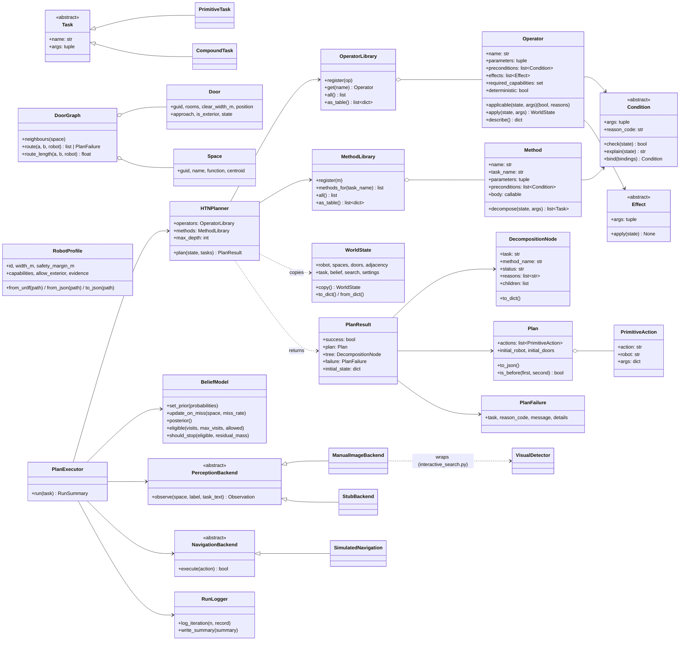

# HTN planning layer: design

Status: **implemented** (`scripts/vlm_reasoning/htn/`), tested (`tests/htn/`,
42 tests), approved with the decisions in section 13.

Reference: Tandon et al., *A graphRAG-based framework for automated,
robot-executable task planning using BIM knowledge graphs and LLMs*
(ECPPM 2026), Sections II ("HTN-based task decomposition from BIM KGs") and
III ("Validation"), `docs/references/ECPPM2026_188.pdf`.

---

## 1. Findings from step 1 (what is actually in the code and data)

### 1.1 Layout

| Expected | Found |
|---|---|
| `scripts/vlm_reasoning/`, `data/cleaned_ifc/`, `venv/`, paper | present |
| `docs/PROJECT_LOG.md` | absent. **The project log is `notes.txt`** (repo root) |
| `data/robot/urdf/` | absent. Created with `a300.urdf` (Clearpath A300) |
| `tests/` | absent; created (`tests/htn/`) |
| `pytest` | was not installed; now `pytest==9.2.0` in `venv/` and `requirements-dev.txt` |

### 1.2 Schema fields used

`IDAC_Model_llm.json`
- `rooms[]`: `guid`, `name` (room key, e.g. `"3"`), `function`, `centroid` [x, y]
- `equipment[]`: used only by the interpreter, as before
- `adjacency[]`: `a`, `b` (space GUIDs or `"outside"`), `via` (door GUID)

`IDAC_Model_full.json`
- `spaces[]`: `guid`, `geometry.footprint` (which side of a door an approach point is on)
- `elements[]` with a `door` block: `guid`, `name`, `geometry.centroid`,
  `door.rooms`, `door.clear_width_m`, `door.swing.opens_towards`,
  `door.probe_offset_m`, `door.is_external`
- `units.output_units.length`

### 1.3 Door/adjacency join (IDAC)

- 15 adjacency edges, 15 doors. **Every edge joins to a door record on GUID;
  every door has a width and a position; each door's `door.rooms` equals its
  edge's two endpoints.** All 30 approach points fall inside the expected room.
- Topology: room 3 (Workspace) ↔ 1, 2, 5, 7, 8, 9, 15, outside; room 5
  (Corridor) ↔ 3, 4, 6, 10, 14; rooms 11, 12, 13 only via 14.
- Widths: 0.885 m (door to outside), 0.9 m (rooms 1, 2, 15), 1.1 m (offices),
  1.26, 1.4, 1.69 m (corridor doors).

### 1.4 Units

`output_units.length = "m"`, factor 1 (project unit METRE). Room 3 `area_m2`
= 156.12 and its footprint polygon measures 156.14 m². **Coordinates are true
metres.** `load_world` refuses any other length unit.

### 1.5 Robot (Clearpath A300)

`data/robot/urdf/a300.urdf` was expanded once from `~/clearpath/robot.urdf.xacro`
with the installed ROS Jazzy `xacro` (nothing was installed).

- **`base_link` has no collision geometry.** `chassis_link` has a mesh (0.461 m
  wide); the wheels are cylinders on their own links and stick out beyond it.
- Width = lateral extent of *all* collision geometry in the `base_link` frame:
  **0.665 m** (outermost links: the front wheels), length 0.995 m. Written to
  `data/robot/profiles/a300.json`, which overrides the URDF from then on.
- Capabilities: `navigate` (mobile base; evidence: four continuous wheel
  joints), `rgb` and `depth` (`<sensor name="camera_0" type="rgbd_camera">`).
  No `manipulate_door`. `gpu_lidar` and `imu` are listed as evidence only.
- 0.665 + 0.1 margin = 0.765 m < 0.885 m: the A300 fits through every IDAC door.

### 1.6 Things that contradicted the prompt

1. **Distances.** Start centroid → doors → target centroid: Office 4 →
   Office 3 **8.3 m** (straight line 5.5 m), Office 5 → Office 6 **13.4 m**
   (5.4 m), Storage → Printer room **6.1 m** (2.6 m). The prompt's 25 / 27 /
   16 m come from also passing through each intermediate room's centroid.
2. **SearchSession re-ranks at most once per task**, not after every miss
   (only when the recorded rooms were checked without a find).
3. **The door to "outside" has `is_external: false`.** Exterior is decided by
   the edge touching `outside`; `load_world` reports the mismatch.
4. **`clear_width_m` is `OverallWidth`** for all doors (no lining data), so it
   overstates the clear opening by the frame.
5. **`synthetic_office_cleaned.json`** has 9 doors with room names and widths
   but no positions, no GUID adjacency and no `_full.json`. The HTN refuses it
   (use `--no-htn`); the tests use hand-built fixtures.

---

## 2. Overview

```
user text ──► interpret_task (LLM, once)                 [existing, + "quantity"]
                 │ find_object / go_to_room
                 ▼
            PlanExecutor ──────────────────────────────────────────────┐
              │  1. WorldState (building + robot + doors + belief)      │
              │  2. HTNPlanner.plan(state, [find_object(target, mode)]) │ no model
              │  3. execute up to the first searched room               │ calls in
              │  4. observe (detector), Bayesian belief update          │ planner
              │  5. log iteration, replan from the new state ───────────┘
              ▼
         RunSummary + results/htn_runs/<timestamp>_<task>/iter_<n>.json, summary.json
```

The planner is the paper's design: rule-based, deterministic, no library,
operator and method libraries, depth-first total-order decomposition on state
copies with backtracking, explicit infeasibility, JSON plans. Everything
specific to object search under uncertainty (priors, detection, belief
update, replanning) sits in the executor, outside the planner.

### Package layout

```
scripts/vlm_reasoning/htn/
  core/        task.py  conditions.py  operator.py  method.py  state.py  planner.py  plan.py
               (domain-independent: imports nothing from domain/ or rank_candidates)
  domain/      building.py  robot.py  operators.py  methods.py  domain.py  world.py
  execution/   belief.py  executor.py  backends.py  run_logger.py
  cli.py       flags + HTNSearch (glue for interactive_search.py)
```

---

## 3. Class diagram



---

## 4. World state

One `WorldState` per planning call; plain JSON data, deep-copied by the planner.

| Field | Content | Source |
|---|---|---|
| `robot` | id, current space, capabilities, width_m, safety_margin_m, allow_exterior | robot profile + executor |
| `spaces` | GUID → name, function, centroid | `_llm.json` |
| `doors` | GUID → rooms, clear_width_m, position, approach points, is_exterior, state | `_full.json` + door-states file |
| `adjacency` | space → list of edges `{to, door, door_action, capabilities}` | `_llm.json` adjacency joined with `_full.json` doors |
| `task` | name, target, mode (`single` / `all`), restricted room, recorded rooms, user text | interpreter |
| `belief` | prior and posterior per space (empty until needed) | ranker + BeliefModel |
| `search` | visits per space, per-space stage, searched / found spaces, observations | operators + executor |
| `settings` | prob_mass, min_prob, max_visits_per_room, distance, door_states_source | CLI |

Adjacency edge (as in the paper): `door_action` is `"none"` for an open door
and `"open"` for a closed one; `capabilities` is `["navigate"]`, plus
`"manipulate_door"` when closed. `SetDoorState` keeps the edges in step with
the door.

**Traversal rule:** a door is passable if it is not exterior (unless
`allow_exterior`), `clear_width_m >= width_m + safety_margin_m`, and it is open
or the robot has `manipulate_door`.

---

## 5. Operators (primitive tasks)

Generated from the code (`OperatorLibrary.as_table()`). `?x` is a parameter.
The capabilities column is checked as an implicit precondition
(`missing_capability`).

| Operator | Parameters | Preconditions | Effects | Capabilities |
|---|---|---|---|---|
| `navigate` | from_space, to_space, door, door_position, approach_from, approach_to, to_centroid | `RobotAt(?from_space)`<br>`DoorConnects(?door, ?from_space, ?to_space)`<br>`DoorOpen(?door)`<br>`DoorFits(?door)`<br>`ExteriorAllowed(?door)` | `RobotMovesTo(?to_space)` | navigate |
| `manipulate_door` | door, action, door_position, approach_point | `RobotBesideDoor(?door)`<br>`DoorClosed(?door)` | `SetDoorState(?door, open)` | manipulate_door |
| `capture_rgb` | space | `RobotAt(?space)` | `SetStage(?space, image)` | rgb |
| `detect` (non-deterministic) | space, target | `ImageCaptured(?space)` | `SetStage(?space, observed)` | - |
| `update_belief` | space | `ObservationPending(?space)` | `CountVisit(?space)`<br>`SetStage(?space, counted)` | - |
| `record_result` | space, target | `VisitCounted(?space)` | `RecordResult(?space)` | - |

- `approach_from` / `approach_to`: door centroid ± `probe_offset_m` along
  `swing.opens_towards`, each labelled with the room whose footprint contains
  it. Everything a later BT/Nav2 exporter needs is in the args.
- `detect` is planned as "not found" (its outcome is only known at run time).
- `update_belief` only counts the visit in the plan; the Bayesian update is
  done by the executor with the real observation.

---

## 6. Methods (compound tasks)

Generated from the code (`MethodLibrary.as_table()`); order = priority.
Methods only read the state: no model calls, no I/O.

| Task | # | Method | Preconditions | Subtasks |
|---|---|---|---|---|
| `find_object(target, mode)` | 1 | `m_search_restricted` | `RestrictedRoomGiven()` | `search_space(room)` if not yet searched, else none |
| | 2 | `m_search_recorded` | `NoRestrictedRoom()`<br>`RecordedRoomsGiven()`<br>`SomeRecordedRoomEligible()` | `search_space(r)` for each eligible recorded room, in route order |
| | 3 | `m_search_semantic` | `NoRestrictedRoom()`<br>`PriorAvailable()`<br>`SomeRoomSelected()` | `search_space(r)` for each selected room, in route order |
| `search_space(space, target)` | 1 | `m_search_space` | `HasCapability(rgb)`<br>`SpaceReachable(?space)` | `go_to`, `capture_rgb`, `detect`, `update_belief`, `record_result` |
| `go_to(space)` | 1 | `m_already_there` | `RobotAt(?space)` | none |
| | 2 | `m_route` | `SpaceReachable(?space)` | per door on the route: `manipulate_door` if closed, then `navigate` |

- **Restricted search never falls back** to other rooms (as in SearchSession):
  methods 2 and 3 require `NoRestrictedRoom`. An infeasible restricted search
  therefore fails with the restricted room's own reason.
- **Recorded → semantic** without special code: once every recorded room is
  searched, `SomeRecordedRoomEligible` fails, `m_search_recorded` is rejected
  (kept in the tree with that reason) and the planner tries `m_search_semantic`.
- **Prior on demand:** with no prior, `PriorAvailable` fails with
  `prior_needed`; the executor asks the ranking model once and replans. A
  restricted search, or one that ends in a recorded room, never calls it.
- **Selection** (`select_rooms`): eligible rooms (visits <
  `max_visits_per_room` and a passable route), their posterior **renormalised
  to sum to 1**, then `select_candidates` (prob_mass, min_prob), then
  `optimal_visit_order` with the chosen distance.

### Routes

`DoorGraph.route` and `route_length` use **the same path: the shortest by
length** (Dijkstra) from the start centroid through door positions to the
target centroid, over passable doors only. An intermediate room's centroid is
never a waypoint.

### Infeasibility

If no passable route exists, the shortest path ignoring passability is taken:
none at all → `unreachable_space`; otherwise the first impassable door on it
gives the code (`door_too_narrow`, `missing_capability`,
`exterior_not_allowed`), and all its blocked doors are in the details. No `rgb`
→ `missing_capability` at `m_search_space`. When all methods of a task fail, a
specific code is passed up if all methods that gave one agree on it; otherwise
the code is `no_applicable_method` with every method's reason. In all cases
there is no plan and no unsupported action.

---

## 7. Executor loop

```
PlanExecutor.run(task):                       (find_object needs --miss_rate)
  loop:
    if find_object and a prior exists:
        eligible ← rooms with visits < max and a passable route
        stop if none, or if their (un-normalised) posterior < residual_mass
    result ← planner.plan(state, [task])
    if result.failure is prior_needed (first time): fetch prior, replan
    if no plan: stop with the failure code (no_eligible_rooms = searched all)
    if empty plan: stop (nothing left)
    execute actions, checking each operator's preconditions again, up to and
      including the first record_result (go_to: all actions)
      at detect: observation ← perception.observe(...)
      at update_belief:
          skipped image → visit counted, belief unchanged
          miss          → P(r) ← P(r) · miss_rate, renormalise all rooms
          found         → recorded; mode single: stop after this iteration
    log iteration
  write summary.json (cli.py)
```

**Found** = `found` is true and `confidence >= --detect_threshold` (default
0.0, the old behaviour). Misses seen before the prior was fetched (in recorded
rooms) are applied to the prior when it arrives.

### What the miss rate does, and what the stop rule assumes

- **With `max_visits_per_room = 1` the miss rate affects only the stop rule,
  not the visit order.** A miss lowers only the searched room, which is then
  no longer eligible. The eligible rooms are all scaled by the same factor, so
  their renormalised distribution, and therefore the selection and the order,
  is unchanged. What changes is their un-normalised mass, which the stop rule
  uses. (Test: `test_miss_rate_only_changes_the_stop_rule_when_each_room_is_visited_once`.)
- With `max_visits_per_room = 2` the order does change (test
  `..._when_rooms_can_be_revisited`). Note: the shortest-tour ordering then
  often re-searches the current room straight away, because that costs 0 m.
- **The stop rule assumes the target is in the building.** The posterior is
  over the building's rooms only, so "remaining probability < residual_mass"
  means "probably in a room already searched (and missed)", never "not here".
- Mode `all` keeps searching after a find; the belief model still assumes one
  location, so after a find the remaining probabilities are only a heuristic.

### Model calls (only in the executor)

| Call | Where | When |
|---|---|---|
| `interpret_task` + `validate_interpretation` | `interactive_search.py` | once per input |
| `call_ollama` → `validate_rankings` → `softmax_probabilities` | ranker in `cli.py`; returns `[{space, probability, likelihood, reasoning}]`, printed and logged with the model's reasoning per room | at most once per task |
| `VisualDetector.detect` | `ManualImageBackend` | at each `detect` with an image |

All use `build_ollama_options(--llm_temperature, --seed)`.

---

## 8. Deviations

### From the specification

1. **Robot width from all collision geometry**, not the base link (1.5).
2. **`execution/logging.py` → `execution/run_logger.py`**, to avoid confusion
   with the standard library `logging`.
3. **Reason code `prior_needed`**: lets the planner ask for room probabilities
   without a model call; the executor fetches them only when needed.
4. **Door states:** `--door_states`, default `data/robot/door_states_<stem>.json`
   or `door_states_<first token>.json` (IDAC: `door_states_IDAC.json`, all open,
   marked as assumed). Without a file all doors are open, written into the
   state as `"door_states_source": "assumed: all open (no door-states file)"`.
5. **`--miss_rate` is a required flag** for the HTN (no default; recorded in
   `summary.json`). Not in the robot profile: it depends mostly on the VLM and
   the target, not on the robot. Planned: measure it on a labelled image set
   and move it to a detector config file.
6. **Exterior door** = edge touching `outside`, not `door.is_external` (1.6 #3).
7. **Routes by Dijkstra (shortest length), not BFS** (spec and paper use BFS):
   `route` and `route_length` must describe the same path; with BFS the robot
   would drive the fewest-doors path while Held-Karp ordered rooms by another
   path's length. Test: a cycle where the 1-door path is longer than the
   3-door path (`test_route_and_route_length_are_the_same_shortest_path`).
8. **Selection on the renormalised eligible posterior** (section 12 of the
   approved proposal); the stop rule stays on the un-normalised mass.
9. Small API differences, for simplicity: `Method` takes a `body` function
   instead of subclassing; `search_space(space, target)` carries the target;
   `PlanExecutor(planner, state, belief, perception, navigation, ranker,
   logger, ...)` takes the world state rather than a "domain" object;
   `BeliefModel.eligible(visits, max_visits, allowed)` has no `min_prob`
   (applied in `select_candidates`); a profile JSON replaces the URDF-derived
   profile as a whole.

### From the paper

1. **Search instead of inspection**: `search_space` = capture_rgb + detect +
   update_belief, since the object's location is unknown.
2. **Ordering**: Held-Karp (optimal for ≤ 18 rooms) over door-graph distances,
   instead of the paper's greedy multi-target BFS.
3. **Routes**: Dijkstra by length instead of BFS (deviation 7 above).
4. **Replanning loop**: plan → execute → observe → replan, because each
   detection changes the state. The paper plans once.
5. **Granularity**: per space (where to look), not per element.
6. **No HTN-to-BT export** (out of scope); each primitive is one
   `{"action", "robot", "args"}` with positions and approach points.

---

## 9. Changes to existing files

| File | Change |
|---|---|
| `rank_candidates.py` | `optimal_visit_order(candidates, centroid_lookup, start_room, max_exact=18, distance=None)`: `distance(room_a, room_b) -> metres`, default the straight line between `centroid_lookup` centroids. Held-Karp unchanged; the distance from start, the matrix and the reconstructed leg lengths call `distance` instead of `euclidean`. `_greedy_nearest_neighbor` takes the same function. Default output identical to before (test against a verbatim copy of the old function, 50 random cases). |
| `rank_candidates.py` | Interpreter: one field rule (`"quantity"`: `"all"` if every instance is wanted, else `"one"`) and `"quantity": "<one\|all>"` in the JSON shape of `INTERPRET_SYSTEM_PROMPT`; `validate_interpretation` returns `quantity` (default `"one"`). Nothing else changed. |
| `test_interpreter.py` | `BUILTIN` items may carry an expected quantity as a third element; 4 cases added; the quantity is printed and checked. |
| `interactive_search.py` | `find_object` and `go_to_room` go through `HTNSearch` → `PlanExecutor` unless `--no-htn`; the `SearchSession` search is unchanged behind `--no-htn`. New flags (in `htn/cli.py`): `--no-htn`, `--robot`, `--door_states`, `--miss_rate` (required with the HTN), `--detect_threshold` (0.0), `--max_visits_per_room` (1), `--residual_mass` (1 − prob_mass), `--distance {door_graph, euclidean}` (door_graph). Robot position and door states carry over between tasks. |
| new | `data/robot/urdf/a300.urdf`, `data/robot/profiles/a300.json`, `data/robot/door_states_IDAC.json`, `requirements-dev.txt` (`pytest==9.2.0`), `pytest.ini`, `tests/htn/` |

---

## 10. Output JSON

`results/htn_runs/<timestamp>_<task-slug>/iter_<nn>.json`

```json
{
  "iteration": 3,
  "task": {"name": "find_object", "args": ["first aid kit", "single"]},
  "state": {"robot": {}, "spaces": {}, "doors": {}, "adjacency": {}, "task": {}, "belief": {}, "search": {}, "settings": {}},
  "prior": {"<space guid>": 0.41},
  "posterior": {"<space guid>": 0.12},
  "chosen_method": "m_search_semantic",
  "tree": {"task": "goal(find_object(first aid kit, single))", "status": "expanded",
           "children": [{"task": "find_object(first aid kit, single)", "method": "m_search_semantic",
                         "status": "expanded",
                         "children": [{"task": "find_object(...)", "method": "m_search_restricted",
                                       "status": "rejected",
                                       "reasons": ["precondition_failed: the user did not restrict the search to one room"]},
                                      "..."]}]},
  "plan": {"initial_robot": {"id": "a300", "space": "<guid>", "capabilities": ["depth", "navigate", "rgb"]},
           "initial_doors": {"<door guid>": "open"},
           "actions": [{"action": "navigate", "robot": "a300",
                        "args": {"from_space": "<guid>", "to_space": "<guid>", "door": "<guid>",
                                 "door_position": [29.99, 19.121], "approach_from": [29.598, 19.121],
                                 "approach_to": [30.382, 19.121], "to_centroid": [37.1, 18.9]}}]},
  "failure": null,
  "executed": [{"action": "navigate"}, {"action": "capture_rgb"}, {"action": "detect"},
               {"action": "update_belief"}, {"action": "record_result"}],
  "observation": {"space": "<guid>", "found": false, "confidence": 0.1, "description": "...",
                  "skipped": false, "error": null, "aborted": false},
  "posterior_after": {"<space guid>": 0.03}
}
```

`summary.json`: task, robot, settings (incl. `miss_rate`, `detect_threshold`,
`residual_mass`, `distance`, `llm_temperature`, `seed`, model), `outcome`
(`found` / `not_found` / `reached` / `infeasible` / `aborted`) and `reason`,
found spaces, visit order (GUIDs and labels), metres travelled, iterations,
model calls, failure, and `rankings` (probability, score and the model's
reasoning per room; also in the `iter_<nn>.json` that asked the model).

---

## 11. Tests (`python -m pytest`), mapped to the paper's criteria

43 tests, all passing, no Ollama (ranker and detector stubbed).

| Criterion | Tests |
|---|---|
| framework (toy domain, `test_core.py`) | backtracking to the second method with the rejected one in the tree and its reason; backtracking into an earlier task when a *later* task fails; `Operator.apply` never mutates; same input → same plan; missing capability; library errors; abstract `Task` |
| determinism | IDAC with fixed priors: identical Plan JSON in 10 runs |
| completeness | every used compound task decomposes fully; primitives = plan actions |
| correctness | simulated execution meets every precondition; every selected room searched in order |
| ordering | `manipulate_door` before `navigate` through a closed door; route continuity |
| groundedness | every space, door, position, approach point, capability and target comes from the building, profile or state |
| infeasibility | room behind a closed door without `manipulate_door`; isolated room (`unreachable_space`); door narrower than robot + margin; no `rgb`; exterior door never routed |
| robot profile | known box → width; wheel sticking out widens it; capabilities + evidence; two URDFs without `--robot` → list; empty folder; profile JSON overrides; unresolvable mesh stops; committed A300 profile |
| belief / executor | miss lowers by the miss rate and sums to 1; stop rule; find stops; restricted search never calls the ranker; recorded → semantic with one ranker call; skipped image leaves the belief unchanged; miss rate changes the order only with `max_visits_per_room = 2`; `--miss_rate` required; go_to |
| distances | Office 4 → Office 3 via rooms 5 and 14; Dijkstra on a cycle (route and length agree); default `optimal_visit_order` identical to the old function |

---

## 12. Limitations

- **Route length uses straight lines between doors inside a room**, which can
  cross furniture in large rooms such as room 3 (Workspace, 156 m²).
- `clear_width_m` is `OverallWidth` (1.6 #4), so door clearance is optimistic.
- Door states and the miss rate are assumed values, not measured.
- The visit order minimises distance only (as specified): a nearby
  low-probability room can come before a likely one further away.
- Belief model assumes a single target location (see 7 on mode `all`).
- Detector false positives are not modelled (only misses); see 14, run A.
- Skipped images count as visits, so skips alone can end a search by the stop rule.

---

## 13. Decisions (approved)

1. Design approved incl. deviations; routes by Dijkstra with `route` and
   `route_length` on the same path; project log = `notes.txt`.
2. Selection on the eligible posterior renormalised to 1; stop rule on the
   un-normalised eligible mass.
3. `--miss_rate` required flag for HTN `find_object` runs, recorded in
   `summary.json`; later measured and moved to a detector config file.
4. `pytest` installed in `venv/`; `requirements-dev.txt` pins `pytest==9.2.0`.

---

## 14. End-to-end run (step 5)

"find the first aid kit" on `IDAC_Model_llm.json`, `qwen3.5:9b`,
`--llm_temperature 0 --seed 42 --miss_rate 0.2` (assumed value), A300, all
doors open, start room 1 (first room in the file). The real
`SearchSession` + `HTNSearch` path, with the image prompt answered by a script.
Logs: `results/htn_runs/20261028_153230_find_the_first_aid_kit/` (A) and
`results/htn_runs/20261028_153439_find_the_first_aid_kit/` (B).

- Interpreter: `find_object`, mode `single`; the IFC records no first aid kit.
- Plan 1: `m_search_restricted` and `m_search_recorded` rejected,
  `m_search_semantic` → `prior_needed`. One ranking call. Prior: Storage 0.216,
  Lab 0.131, Lobby 0.080, Meeting room 0.080, offices and Workspace 0.048 each,
  Printer room and Corridor 0.029 (identical in both runs).

| Plan | Rooms planned (visit order) | Searched | Result |
|---|---|---|---|
| 2 | 2 Storage → 3 Workspace → 7 Office 8 → 15 Lab → 9 → 8 → 6 → 4 Lobby → 10 → 11 → 14 → 12 → 13 | 2 Storage | miss (A, B) |
| 3 | 3 → 7 → 15 → 9 → 8 → 6 → 4 → 10 → 11 → 14 → 12 → 13 | 3 Workspace | A: **"found", 0.95 (false positive**: fire-extinguisher cabinet); B: miss |
| 4 | 7 → 15 → 9 → 8 → 6 → 4 → 10 → 11 → 14 → 12 → 13 | 7 Office 8 | B: miss |
| 5–11 | same order, one room fewer each time (Corridor joins at plan 6) | 15 Lab, 9 Office 7, 8 Office 6, 6 Office 5, 5 Corridor, 4 Lobby, 10 Office 4 | B: skipped |
| 12 | 13 → 12 → 14 → 11 → 1 Printer room (re-selected after renormalising) | 13 Office 1 | B: skipped |
| 13–15 | 12 → 14 → 11 → 1, then shorter | 12 Office 2, 14 Meeting room, 11 Office 3 | B: skipped |

Run B stopped after 14 rooms and 16 plans: "remaining probability 0.039 <
residual_mass 0.100"; 121.7 m; 1 ranking call, 3 detector calls.
